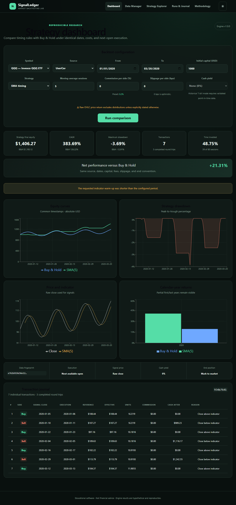

# SignalLedger

**Backtests you can inspect, not just admire.** SignalLedger is an open-source lab for comparing Buy & Hold with SMA/EMA market-timing strategies using next-session execution, visible costs, reproducible data fingerprints, and an auditable trade ledger.



> [!WARNING]
> Results are hypothetical, use price returns rather than total returns, and do not predict future performance. SignalLedger is educational software, not financial advice.

## What is included

- CSV-first daily OHLC import with validation, audit history, and SQLite persistence.
- Optional server-side Yahoo Finance history for `^NDX`, `^IXIC`, `^GSPC` and `QQQ`: downloaded once (up to 30 years), cached in SQLite, then kept current by fetching only missing trading sessions — a current cache makes zero provider requests.
- Persistent background download jobs with progress, cancellation, duplicate prevention, retries and restart recovery; optional hourly automatic synchronization.
- Deterministic Buy & Hold, SMA, and EMA simulations with next-open fills, commission, slippage, drawdown, CAGR, Sharpe, and trade journals — always on locally cached data, so they work offline and with the provider disabled.
- Strategy Explorer with bounded parameter grids, rolling windows, training/holdout separation, cancellation, CSV export, and drilldowns.
- Responsive React dashboard with a Market Data manager, browser accessibility/regression tests, and a synthetic public-demo dataset.
- One-folder ASP.NET Core publish that runs under Kestrel or IIS (in-process, `web.config` included); no Node process or paid service is needed in production.

## Quick start

Prerequisites: .NET SDK 10.0.401 (or compatible patch), Node.js 22+, npm 10+, and PowerShell 7 recommended.

```powershell
dotnet restore SignalLedger.slnx
dotnet test SignalLedger.slnx -c Release
cd src/signal-ledger-web
npm ci
npm run dev
```

In another terminal, run `dotnet run --project src/SignalLedger.Api`. Use `samples/synthetic-prices.csv` for a small offline import. Production public-demo mode automatically creates a deterministic 2,600-session `SYNTH` series and disables CSV import and provider sync.

## Verify and publish

```powershell
dotnet test SignalLedger.slnx -c Release
cd src/signal-ledger-web
npm run lint
npm run build
npm run test:e2e
cd ../..
.\scripts\publish.ps1
```

The publish script produces and smoke-tests `artifacts/publish` (API, SPA assets and IIS `web.config`): it validates `web.config` and the IIS script, then checks `/health`, `/api/health`, the JSON `/api` 404 and SPA deep links. Run it with `dotnet SignalLedger.Api.dll` or host it in IIS. See [deployment](docs/DEPLOYMENT.md) for configuration, HTTPS, backup, migration and rollback.

## Market data

SignalLedger does not bundle or redistribute downloaded market data. You can import CSV files you are licensed to use, or let the server download history from Yahoo's chart endpoint:

1. Review Yahoo's current terms. Yahoo's endpoint is unofficial and undocumented; enabling it is your responsibility.
2. Set `SignalLedger__Yahoo__AuthorizedUseConfirmed=true` and `SignalLedger__Yahoo__Enabled=true` (environment variables or `appsettings`).
3. To manage downloads from the browser, also set `SignalLedger__Administration__AllowHttpDownloadOperations=true` (and optionally `AllowHttpSettingsChanges=true`). These are off by default because SignalLedger has no authentication — enable them only on a trusted network; use `SignalLedger__ReadOnlyMode=true` for public sites.
4. Open **Data Manager → Market data provider → Download Historical Data**. Jobs run on the server; you can close the browser.

After the first download, *Sync missing data* (or automatic sync every `SyncIntervalMinutes`) requests only completed sessions that are not cached yet, using a US exchange calendar (weekends, holidays, closures, New York time). *Repair gaps* fills holes inside the cached history; *Force refresh* re-downloads one explicit date range. Details: [market data](docs/MARKET_DATA.md).

`^NDX`, `^IXIC`, and `^GSPC` are non-tradable price-index proxies; their OHLC values are not Bid/Ask. QQQ raw-price tests exclude distributions and are not total-return results.

## Hosting

- Kestrel / any service manager: [deployment](docs/DEPLOYMENT.md).
- IIS on Windows Server (in-process, AlwaysRunning, preload, Application Initialization): [IIS deployment](docs/IIS_DEPLOYMENT.md) and `scripts/deploy-iis.ps1` (run it yourself on the target server; supports `-WhatIf`).

The SQLite database (`SignalLedger:DataDirectory`) must live outside the release folder; it holds cached prices, settings, runs and jobs and survives restarts and redeployments.

## Data and methodology

Read [data sources](docs/DATA_SOURCES.md), [market data](docs/MARKET_DATA.md), [backtest assumptions](docs/BACKTEST_ASSUMPTIONS.md), and the [disclaimer](docs/DISCLAIMER.md) before interpreting results. The implementation checklist and verification record are in [the plan](plans/SignalLedger_IMPLEMENTATION_PLAN.md); coding agents follow [AGENTS.md](AGENTS.md).

## Contributing and license

Read [CONTRIBUTING.md](CONTRIBUTING.md) and [CODE_OF_CONDUCT.md](CODE_OF_CONDUCT.md). Application source is MIT licensed; this grants no rights to third-party market data. Dependency licenses are summarized in [third-party notices](docs/THIRD_PARTY_NOTICES.md).
